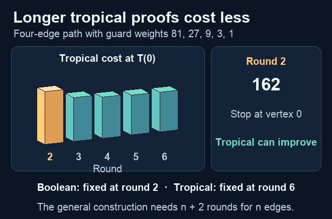

# Boolean boundedness need not transfer to tropical Datalog

One fixed three-rule program stabilizes all its intensional predicates over Boolean inputs by **round 2**. The same program first attains the final tropical value of its target at **round n + 2** on a path with n edges. This answers the transfer question of Fan, Koutris and Roy. [Original question, p. 93:10](https://arxiv.org/pdf/2504.08914v1#page=10)

[Paper PDF](paper/manuscript.pdf) · [LaTeX source](paper/manuscript.tex) · [Proof outline](proof/PROBLEM_AND_PROOF.md)

## The cost of stopping early

Stopping uses the same guard twice. Boolean conjunction absorbs the duplication, while tropical multiplication adds the weight twice. On the chosen paths, every additional edge lowers the total derivation cost.

[Download the offline explorer ZIP](https://raw.githubusercontent.com/DannyExperiments/boolean-tropical-datalog-boundedness/v1.0.0/visualization/boolean-tropical-datalog-boundedness-explorer.zip) · [Worked example](visualization/README.md)

## Scope and checks

A separate target-only example has constant Boolean circuit depth and worst-case tropical depth $\Theta(\log^2 m)$ in the specified nonnegative integer model. The proof uses integer threshold tests and the classical monotone connectivity lower bound. It leaves the general Datalog depth classification open. [Claim scope](CLAIM_SCOPE_AND_LIMITATIONS.md) · [Literature audit](audits/public_safe_reports/LITERATURE_AUDIT.md)

Exact Python replay checks the path costs, finite Boolean databases, gate tests and positive-length matrix formula. A partial Lean certificate checks the worked trace and arithmetic identities. Internally reviewed, not peer reviewed. [Reproducibility](REPRODUCIBILITY.md) · [Technical disclosure](AI_DISCLOSURE.md)

DannyExperiments is the preferred citation identity. [Release v1.0.0](https://github.com/DannyExperiments/boolean-tropical-datalog-boundedness/releases/tag/v1.0.0) · [Version DOI](https://doi.org/10.5281/zenodo.24572909) · [Citation metadata](CITATION.cff)
